# Hi, I'm Hwi 👋

  

  

## 🛠️ Tech Stack

  

  
  
  

## 🚀 Projects

<table>
  <tr>
    <td width="50%">
      <h3 align="center">⌬ HEXORA</h3>
      
Educational Math Platform

      

        
      

    </td>
    <td width="50%">
      <h3 align="center">🚗 Car Damage AI</h3>
      
AI-powered Vehicle Damage Analysis

      

        
      

    </td>
  </tr>
</table>

## 📊 GitHub Stats

  
  

  

## 📈 Activity Graph

<!-- BEGIN ACTIVITY-GRAPH -->
<picture>
  <source media="(max-width: 767px)" srcset="activity-graph-mobile.svg">
  
</picture>
<!-- END ACTIVITY-GRAPH -->

  <i>Build · Experiment · Learn · Repeat</i>

